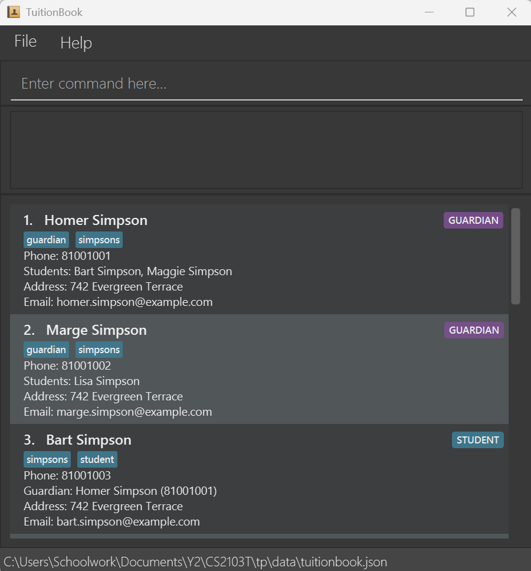
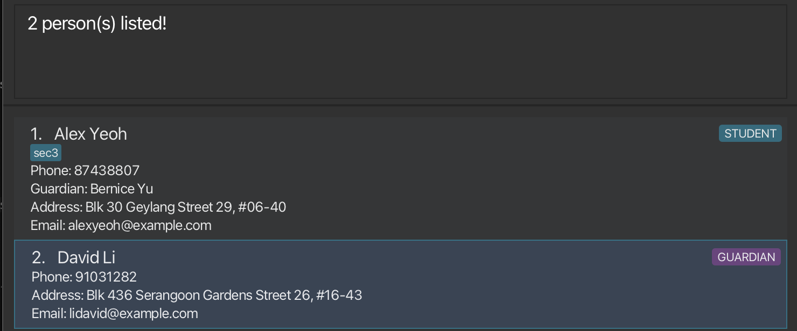

# TuitionBook User Guide

TuitionBook is a **desktop application for managing tutoring contacts, optimized for use through a Command Line Interface (CLI)** while retaining the benefits of a Graphical User Interface (GUI). If you type quickly, TuitionBook can help you manage students and guardians faster than traditional GUI applications.

TuitionBook is intended for English-language users and supports any `en-*` locale. Text input is encoded as UTF-8. Field-specific validation rules apply to names, addresses, phone numbers, email addresses, and tags.

<!-- * Table of Contents -->
<page-nav-print />

--------------------------------------------------------------------------------------------------------------------

## Command summary

Action     | Format, Examples
-----------|----------------------------------------------------------------------------------------------------------------------------------------------------------------------
**Add**    | `add r/ROLE n/NAME p/PHONE [e/EMAIL] [a/ADDRESS] [t/TAG]...`   e.g., `add r/student n/James Ho p/22224444 e/jamesho@example.com a/123, Clementi Rd, 1234665 t/friend t/colleague`
**Clear**  | `clear confirm`
**Delete** | `delete INDEX`  e.g., `delete 3`
**Edit**   | `edit INDEX [n/NAME] [p/PHONE] [e/EMAIL] [a/ADDRESS] [t/TAG]...`  e.g.,`edit 2 n/James Lee e/jameslee@example.com`
**Exit**   | `exit`
**Reload** | `reload`
**Find**   | `find KEYWORD [MORE_KEYWORDS]...` (name substrings)  e.g., `find rac bob`
**Help**   | `help`
**Link**   | `link STUDENT_INDEX GUARDIAN_INDEX`   e.g., `link 1 2`
**List**   | `list [r/ROLE] [t/TAG]...`  e.g., `list r/student t/ACTIVE t/math`
**Unlink** | `unlink STUDENT_INDEX`  e.g., `unlink 1`
**View**   | `view INDEX [v/]`  e.g., `view 1 v/`

--------------------------------------------------------------------------------------------------------------------

## Quick start

1. Ensure that Java `25` or later is installed on your computer. 
   **Mac users:** Ensure you have the precise JDK version prescribed [here](https://se-education.org/guides/tutorials/javaInstallationMac.html).

1. Download the latest `.jar` file from the project's [GitHub Releases](https://github.com/AY2627S1-CS2103T-T16-2/tp/releases) page.

1. Copy the file to the folder you want to use as the _home folder_ for your TuitionBook.

1. Open a terminal. Replace the example JAR path below with the actual location of your downloaded JAR. You may run the command from any folder.

   * **macOS/Linux:** `java -jar "/path/to/tuitionbook.jar"`
   * **Windows:** `java -jar "C:\path\to\tuitionbook.jar"`

   A GUI similar to the one below should appear in a few seconds. If no data file exists, TuitionBook starts with an empty contact list and shows an information dialog. Dismiss the dialog to use the app. 
   

1. Type a command in the command box and press Enter to execute it. For example, type **`help`** and press Enter to open the help window. 
   Some example commands you can try:

   * `list` : Lists all contacts.

   * `add r/student n/John Doe p/98765432 e/johnd@example.com a/John street, block 123, #01-01` : Adds a student contact named `John Doe` to TuitionBook.

   * `delete 1` : Deletes the 1st contact shown in the current list.

   * `clear confirm` : Deletes all contacts, including contacts hidden by the current filter.

   * `exit` : Exits the app.

1. Refer to the [Features](#features) section below for details of each command.

--------------------------------------------------------------------------------------------------------------------

## Features

<box type="info" seamless>

**Notes about the command format:** 

* Words in `UPPER_CASE` are the parameters to be supplied by the user. 
  For example, in `add n/NAME`, replace `NAME` with a value such as `John Doe`.

* Items in square brackets are optional. 
  For example, `n/NAME [t/TAG]` can be used as `n/John Doe t/friend` or as `n/John Doe`.

* Items followed by `...` can appear zero or more times. 
  For example, `[t/TAG]...` may be omitted, or written as `t/friend` or `t/friend t/family`.

* Parameters can be in any order. 
  For example, if the command specifies `n/NAME p/PHONE`, `p/PHONE n/NAME` is also acceptable.

* Extraneous parameters for commands that take no parameters, such as `help` and `exit`, are ignored. 
  For example, `help 123` is interpreted as `help`.

* If you are using a PDF version of this document, be careful when copying and pasting commands that span multiple lines as space characters surrounding line-breaks may be omitted when copied over to the application.
</box>

### Viewing help: `help`

Opens the Help window, which contains a scrollable summary of every command and its syntax.

Format: `help`

* You can also open or focus the same Help window by clicking the one-click `Help` control at the top of the main window, or by pressing <kbd>F1</kbd> even while the command box has focus.
* Use `Open User Guide` to open this User Guide in your system's default browser.
* If TuitionBook cannot open a browser, the Help window displays fallback guidance and remains open. Use `Copy URL` to copy the User Guide address and open it manually.
* An internet connection is needed to open the linked page itself.

### Adding a contact: `add`

Adds a student or guardian contact to TuitionBook.

Format: `add r/ROLE n/NAME p/PHONE [e/EMAIL] [a/ADDRESS] [t/TAG]...`

* `ROLE`, `NAME`, and `PHONE` are mandatory.
* `ROLE` must be either `student` or `guardian`, case-insensitively.
* `NAME` must start with a Unicode letter or number. It may contain Unicode letters and numbers, Unicode combining marks, spaces, periods (`.`), straight apostrophes (`'`), forward slashes (`/`), and hyphens (`-`). Surrounding whitespace is ignored, while the accepted name's capitalization, punctuation, and Unicode representation are preserved.
* `NAME` can contain at most 100 characters.
* In `add` and `edit`, wrap the entire name in straight double quotes when it contains a field prefix: `n/"Rina a/p Kaur"`. The quotes are not stored and do not count towards the name length. Ordinary names still work without quotes.
* **Unquoted names still use normal field parsing:** `n/Rina a/p Kaur` is interpreted as name `Rina` and address `p Kaur`, not as the full name. Use `n/"Rina a/p Kaur"` to preserve it.
* `PHONE` must contain at least three digits. It may start with `+`, and a single space or hyphen may appear between digits. These formatting characters are preserved.
* `EMAIL` and `ADDRESS` are optional. If supplied, `ADDRESS` must not be blank and can contain at most 200 characters. For example, `😀` counts as one character. Surrounding whitespace is ignored; the address is otherwise preserved as entered.
* Each `TAG` must be non-blank and may contain ASCII letters, digits, spaces, and printable punctuation, such as `Sec 4`, `Math--Science`, `C++`, or `Mrs. Lim's`. Leading, trailing, and repeated hyphens are allowed. Non-ASCII characters and internal control characters (such as tabs or newlines) are not accepted. Surrounding whitespace is trimmed; internal spaces, punctuation, spelling, and capitalization are preserved.
* **Use consistent spacing in tags.** `Sec 4` (one internal space) and `Sec  4` (two internal spaces) are different tags, even though they may look similar. `list t/Sec 4` will not match a contact whose only tag is `Sec  4`. This is intentional: only surrounding whitespace is trimmed, and repeated internal spaces are not collapsed. Use the same internal spacing when adding, editing, and filtering tags.
* Tags do not need quotes merely to contain spaces. Wrap the entire tag in straight double quotes when it contains text that resembles a field prefix recognised by the command: `t/"meet at a/c room"`. The quotes are not stored. Without the quotes, `a/c room` is parsed as an address in `add` and `edit`. In `list`, quoting similarly protects embedded `r/` and `t/` text.
* For a quoted name or tag, after the closing quote, end the command or enter a space followed by another field prefix. Missing closing quotes and extra text after the closing quote are rejected.
* Inside a quoted value, use `\"` for a literal double quote and `\\` for a literal backslash. For example, `t/"\"Sec 4\""` stores the tag `"Sec 4"` including its literal quotes, while `t/"Sec 4"` stores `Sec 4`. Use `t/"C:\\Math\\"` for a tag ending in a backslash. A backslash before any other character is preserved (for example, `\M` stays `\M`); sequences such as `\n` do not insert newlines. Unquoted values keep their quotes and backslashes literally, unless the first non-whitespace character is `"`, which starts quoted syntax. Decoded values still follow normal field validation: double quotes and backslashes are allowed in tags but not names.
* `g/` is not accepted by `add`; linking a guardian to a student is a separate operation.
* After a contact is added, TuitionBook shows the full contact list: any active name, role, or tag filter is cleared so that the new contact is visible.

<box type="tip" seamless>

**Tip:** A person can have any number of tags, including zero.

TuitionBook treats two contacts as duplicates only when both their normalized names and normalized phone numbers match. Name comparison is case-insensitive, ignores surrounding and repeated spaces, and treats canonically equivalent Unicode forms, such as é and e followed by a combining acute accent, as equal. Phone comparison removes spaces and hyphens while retaining a leading `+`. Country-code equivalence is not applied, so phone numbers that differ by a leading `+` are distinct.

A young student without their own phone number may reuse their guardian's phone number. If an email is supplied, the guardian's email may also be reused. The student and guardian remain distinct contacts because their names differ.
</box>

Examples:
* `add r/student n/John Doe p/98765432 e/johnd@example.com a/John street, block 123, #01-01`
* `add r/guardian n/Betsy Crowe p/1234567 t/family`
* `add r/student n/Alex Lim p/91234567 t/Sec-4 t/referred-by-Mrs-Lim`
* `add r/student n/"Rina a/p Kaur" p/91234567 a/123 Main Street`

### Listing contacts: `list`

Shows all contacts, or only contacts matching a specified role and/or all specified tags. `list` clears any active name, role, or tag filter.

Format: `list [r/ROLE] [t/TAG]...`

* `ROLE` is `student` or `guardian`, case-insensitively.
* Each `TAG` follows the same tag-name rules as [adding a contact](#adding-a-contact-add). Tag matching is exact but case-insensitive; all specified tags must be present.
* Spaces and punctuation are significant: `list t/SEC 4 t/math--science` requires both complete tags. `Sec  4` (two spaces) is different from `Sec 4`; `active!` does not match `inactive!` or `active`. In `list`, a space followed by `r/` or `t/` starts a new filter argument.
* To search for a tag containing `r/` or `t/` after a space, quote the complete tag, for example `list t/"study r/student t/weekly"`.
* Escaping works the same way in `add`, `edit`, and `list`: `list t/"\"Sec 4\""` matches the literal tag `"Sec 4"`, including one loaded from an existing JSON file.
* A filtered `list` replaces any active name, role, or tag filter. No matches is a successful result: `0 person(s) listed!`. Bare `list` restores all contacts in their original order.
* Repeating `t/` applies an additional tag condition. Repeating `r/` is rejected.
* `list r/student` shows only students; `list r/guardian` shows only guardians.
* Other trailing text is rejected.
* Before linking a student to a guardian after applying a filter, enter `list` to restore the full list so that both contacts can be selected.
* Each contact card displays a `STUDENT` or `GUARDIAN` role badge.
* Each contact card labels its phone number, email address, and home address with `Phone:`, `Email:`, and `Address:`.
* Student cards display a `Guardian:` line with the linked guardian's name and contact number, or `-` when no guardian is linked.
* Guardian cards display a `Students:` line with linked student names in contact-list order, or `-` when no students are linked. The names come from the complete contact list even when a filter hides the student cards.
* Missing email addresses and home addresses display as `Email: -` and `Address: -`.
* If a name, phone number, email address, relationship summary, or home address is wider than its card, the card keeps the start visible and uses an ellipsis. Hover over the shortened value to see it in full, or use `view INDEX v/` for a keyboard-accessible full-detail view. The role badge remains visible beside a long name.

### Viewing a contact: `view`

Replaces the contact list with a contact's details and their recorded relationship. The next command other than `view` restores the contact list.

Format: `view INDEX [v/]`

* `INDEX` is the positive index shown in the current contact list. After `find` or `list r/ROLE`, it refers to the filtered list.
* Without `v/`, each linked contact appears as `NAME (CONTACT_NUMBER)`. A student view shows its linked guardian, while a guardian view lists its linked students in contact-list order.
* Add `v/` to show the linked guardian's or linked students' full contact details, including their role, phone, email, address, and tags.
* If a student has no guardian link, the result shows `No guardian linked.` If a guardian has no linked students, it shows `No students linked.` Related contacts are shown even when the current filter hides them.
* Missing optional email, address, or tags are shown as `-`. Tags appear in alphabetical order. `view` does not change contact data or the active filter.

To try the examples below from an empty contact list, enter these commands first:

1. `add r/student n/Alex Yeoh p/87438807`
1. `add r/guardian n/Bernice Yu p/99272758`
1. `link 1 2`

Examples using the contacts created above:

* `view 1` replaces the contact list with Alex Yeoh's details and `Bernice Yu (99272758)` as his linked guardian.
* `view 1 v/` also shows Bernice Yu's full contact details.
* `view 2` replaces the contact list with Bernice Yu's details and lists `Alex Yeoh (87438807)` as a linked student.
* `view 2 v/` also shows Alex Yeoh's full contact details.
* `list r/student` followed by `view 1 v/` still shows Bernice Yu's details, although guardians are hidden from the list.

### Editing a person: `edit`

Edits an existing person in TuitionBook.

Format: `edit INDEX [n/NAME] [p/PHONE] [e/EMAIL] [a/ADDRESS] [t/TAG]...`

Names support the same optional double quotes as `add`. For example, `edit 1 n/"Rina a/p Kaur"` changes the complete name without interpreting `a/` as an address prefix.

* Edits the person at the specified `INDEX`. The index refers to the index number shown in the displayed person list. The index **must be a positive integer** 1, 2, 3, ...
* At least one of the optional fields must be provided.
* To remove an existing email or address, use `e/` or `a/` with no value respectively.
* Existing values will be updated to the input values.
* `edit` cannot change a person's role or guardian link. Use `link` or `unlink` to change a student's guardian link. The role specified with `add` applies only to the new contact.
* `NAME` must start with a Unicode letter or number. It may contain Unicode letters and numbers, Unicode combining marks, spaces, periods (`.`), straight apostrophes (`'`), forward slashes (`/`), and hyphens (`-`). Surrounding whitespace is ignored, while the accepted name's capitalization, punctuation, and Unicode representation are preserved.
* `NAME` can contain at most 100 characters.
* `PHONE` must contain at least three digits. It may start with `+`, and a single space or hyphen may appear between digits. These formatting characters are preserved.
* A supplied `ADDRESS` must not be blank and can contain at most 200 characters. For example, `😀` counts as one character. Surrounding whitespace is ignored; the address is otherwise preserved as entered.
* `TAG` follows the same space-and-punctuation and optional quoting rules described for [`add`](#adding-a-contact-add).
* When editing tags, all of the person's existing tags are removed; adding tags is not cumulative.
* To remove all of a person's tags, enter `t/` without a tag after it.
* After a successful edit, TuitionBook shows the full contact list: any active name, role, or tag filter is cleared.

Examples:
*  `edit 1 p/91234567 e/johndoe@example.com` Edits the phone number and email address of the 1st person to be `91234567` and `johndoe@example.com` respectively.
*  `edit 2 n/Betsy Crower t/` Edits the name of the 2nd person to be `Betsy Crower` and clears all existing tags.

### Linking a student to a guardian: `link`

Links a student contact to a guardian contact.

Format: `link STUDENT_INDEX GUARDIAN_INDEX`

* The first index must refer to a student and the second index must refer to a guardian.
* Both indexes refer to positive index numbers in the currently displayed contact list. Both contacts must be visible. If a filter hides either contact, enter `list` to restore the full list before using `link`.
* If the student already has a different guardian, the previous guardian is unlinked and the result identifies that previous guardian.
* Linking a student to the guardian they are already linked to is idempotent; TuitionBook reports that the link already exists and makes no change.
* After a link is created or replaced, TuitionBook shows the full contact list: any active name, role, or tag filter is cleared. Reporting an already-existing link makes no change, so the displayed list and its filter are preserved.

Example: `link 1 2` links the student at index 1 to the guardian at index 2.

### Removing a guardian link: `unlink`

Removes a student contact's guardian link without deleting either contact.

Format: `unlink STUDENT_INDEX`

* `STUDENT_INDEX` is the positive index shown in the currently displayed contact list. After `find` or a filtered `list`, it refers to the filtered list.
* The index must refer to a student.
* If the student has no linked guardian, TuitionBook reports this and makes no change. The displayed list and any active filter are preserved.
* After a guardian link is removed, TuitionBook shows the full contact list: any active name, role, or tag filter is cleared.

Example: `unlink 1` removes the guardian link of the student at index 1.

### Locating persons by name: `find`

Finds persons whose names contain any of the given literal substrings.

Format: `find KEYWORD [MORE_KEYWORDS]...`

* Each keyword matches anywhere within a name, including the start, middle, or end of a name component. For example, `rac` matches `Grace Tan`.
* The search is Unicode-aware and case-insensitive; for example, `GRACE` matches `Grace Tan`, and `ışık` matches `Işık`.
* The search considers only contact names. Text found only in a phone number, email address, home address, tag, role, or linked contact's name does not match.
* Keywords are treated as literal text, so punctuation is not interpreted as a search pattern.
* Persons matching at least one keyword are returned (an `OR` search). A person is listed only once even if multiple keywords match their name.

Examples:
* `find gr`, `find rac`, `find ace`, and `find GRACE` each return `Grace Tan`.
* `find rac bob` returns contacts whose names contain either `rac` or `bob`, such as `Grace Tan` and `Bob Lim`.
* `find alex david` returns `Alex Yeoh`, `David Li` 
  

### Deleting a person: `delete`

Deletes the specified person from TuitionBook.

Format: `delete INDEX`

* Deletes the person at the specified `INDEX`.
* The index refers to the index number shown in the displayed person list.
* The index **must be a positive integer** 1, 2, 3, ...
* Deleting a guardian keeps their linked students, but clears those students' guardian links.
* Unlike `add`, `edit`, and `link`, `delete` does not clear an active name, role, or tag filter: the remaining contacts of the filtered view stay listed.

Examples:
* `list` followed by `delete 2` deletes the 2nd person in TuitionBook.
* `find Betsy` followed by `delete 1` deletes the 1st person in the results of the `find` command.

### Clearing all entries: `clear confirm`

Clears all entries from TuitionBook, including contacts hidden by the current filter.

Format: `clear confirm`

* The confirmation keyword must be the exact lowercase word `confirm`.
* `clear`, `clear CONFIRM`, and any other trailing text are rejected without deleting contacts.

### Reloading contacts: `reload`

Format: `reload`

Reads the configured contact file again and replaces the current contact list, clearing any active filter. Use this after correcting a file that could not be loaded and backed up. A successful read enables saving again, but does not check write permissions or retry a rolled-back command. Re-enter that command afterwards. No arguments are accepted.

If the file is missing, the contact list becomes empty and saving is enabled. Reloading does not save anything. If reading fails, the current contacts and filter are retained. TuitionBook attempts to preserve the unreadable file in a backup: the error reports the backup path if successful (saving is then enabled), or states that saving remains blocked if preservation fails. Restore corrected data before reloading again if you want to recover contacts from the backup. Reload replaces rather than merges contacts; preserve any external file edits you need before using it.

### Exiting the program: `exit`

Exits the program without attempting to save contact data.

Format: `exit`

### Saving the data

TuitionBook attempts to save contact data after commands that change contacts or guardian links. Read-only commands, including `help` and `exit`, do not save contact data. If saving fails, TuitionBook displays an error and restores the contacts and active filter to their state before the command. You do not need to save manually.
If TuitionBook cannot load an existing data file, it shows a startup warning with the recovery outcome. When it successfully moves the unreadable file to a backup, you can save new contacts. If it cannot create that backup, saving remains blocked until you correct or move the original file and run `reload` or restart the app.

### Editing the data file

TuitionBook stores its data, preferences, and logs relative to the folder containing the JAR, regardless of the folder from which it is launched. Contact data is saved automatically as a JSON file `[JAR file location]/data/tuitionbook.json`. Advanced users are welcome to update data directly by editing that data file. On first launch after upgrading from an earlier version, TuitionBook moves the existing `data/addressbook.json` to this path. If both files are present, it uses `tuitionbook.json` and leaves `addressbook.json` unchanged.

Each contact in the file has these relationship fields:

* `id`: the contact's unique identifier. It must be a valid UUID and must not be repeated in the file.
* `role`: either `STUDENT` or `GUARDIAN`.
* `guardianId`: optional. For a student, it is the `id` of a guardian contact; guardians must have no guardian link (the field is absent or `null`).

Do not change an existing `id` when editing the file. A current-format contact must include valid `id` and `role` fields. Contacts with the same normalized name and phone number are duplicates and make the file invalid, even when their `id` values differ.

Data files created before these relationship fields were introduced remain supported. A contact that has none of `id`, `role`, or `guardianId` is loaded as an unlinked student and receives a generated `id`. The updated fields are written when TuitionBook next saves the data file.

If a `guardianId` is malformed, refers to a missing contact, refers to a student, or links a student to itself, TuitionBook keeps the contact but removes that guardian link when loading the file. A startup warning gives the number of links repaired. Review the `guardianId` values in the data file before entering a contact-changing command; the next save removes invalid links. A guardian contact's own `guardianId` is also removed if present.

<box type="warning" seamless>

**Caution:** If your changes make the data file invalid, TuitionBook starts with an empty contact list and shows a warning at the next run. It moves the unreadable file unchanged to `tuitionbook.json.backup`. If that name already exists, it uses the next available name such as `tuitionbook.json.backup.1`; the warning names the exact backup path. The backup is kept unchanged, and TuitionBook can then save new contact data to `tuitionbook.json`. 
To restore the original data, first fix the JSON in the backup file, then rename it to `tuitionbook.json`, replacing the new file, and restart TuitionBook. Contacts added after recovery are stored in the new file and must be re-entered because TuitionBook cannot merge the two files automatically. If the backup cannot be created, TuitionBook leaves the original file in place and blocks saves; correct or move that file, then restart TuitionBook. Still, we recommend backing up the file before editing it. 
Furthermore, certain edits can cause TuitionBook to behave in unexpected ways (e.g., if a value entered is outside of the acceptable range). Therefore, edit the data file only if you are confident that you can update it correctly.

The 100-character name limit and 200-character address limit also apply to values edited directly in the data file. A file containing a longer value is invalid and follows the recovery behavior above: TuitionBook moves it unchanged to an unused sibling backup and allows new data to be saved; if that backup cannot be created, TuitionBook leaves the original file in place and blocks saves.
</box>

### Archiving data files `[coming in v2.0]`

_Details coming soon ..._

--------------------------------------------------------------------------------------------------------------------

## FAQ

**Q**: How do I transfer my data to another computer? 
**A**: Install the app on the other computer and overwrite the data file it creates with the data file from your previous TuitionBook home folder.

--------------------------------------------------------------------------------------------------------------------

## Known issues

1. **When using multiple screens**, if you move the application to a secondary screen, and later switch to using only the primary screen, the GUI will open off-screen. The remedy is to delete the `preferences.json` file created by the application before running the application again.
2. **Unquoted name text resembling a parameter prefix** (e.g. `a/` in `Rina a/p Kaur`) is still read as a separate field. Wrap the entire name in straight double quotes: `n/"Rina a/p Kaur"`. Slashes without a recognised prefix, as in `Muhammad s/o Ali`, also work without quotes.
3. **Phone numbers are compared literally** (ignoring spaces and hyphens) when detecting duplicates: `+6591234567` and `91234567` are treated as different numbers. Enter phone numbers in a consistent format.
4. **Two contacts may share a name**: only a matching name *and* phone number counts as a duplicate. To tell namesakes apart at a glance, add a distinguishing suffix, e.g. `Tan Wei Ming - Sec 2`.
5. **A contact's role cannot be changed after it is added.** To correct a wrong role, delete the contact and add it again, then re-create any guardian links.
6. **`delete` and `clear confirm` cannot be undone.** The `clear` command requires the explicit lowercase confirmation keyword, but `delete` asks for no confirmation. Removed data is gone immediately; keep a copy of the data file if you may need it. An undo feature is planned `[coming in a future version]`.
7. **Each contact has exactly one role.** A person who is both a guardian and a student (e.g. an older sibling who pays for a younger one) needs two separate contacts with distinguishable names.
8. **If the data file is invalid or corrupted, TuitionBook starts with an empty contact list and a warning.** If it successfully moves the original bytes to a sibling backup named `tuitionbook.json.backup` (or the next available numbered name), the warning gives the exact backup path and TuitionBook allows new data to be saved. To recover the original data, fix the JSON in the backup, rename it to `tuitionbook.json` (replacing the new file), and restart; contacts added after recovery must be re-entered because the files cannot be merged automatically. If the backup fails, the original remains in place and saving is blocked; correct or move it, then restart.
